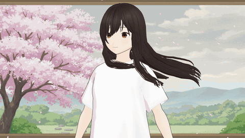

# Regrowth: a HairDeck demo

[](https://az9713.github.io/hairdeck-demo/)

**[Play the full film with music (90 s)](https://az9713.github.io/hairdeck-demo/)**

The image above is a silent 13 s preview. Select it to open the player page, because a GitHub README cannot run a video player from a Pages site.

Regrowth is an animated short film with music and no dialogue. A young woman with long hair cuts it during chemotherapy and loses the rest. Her hair then returns in a new form.

The film is a test of [HairDeck](https://github.com/hyz317/HairDeck), which makes animation-ready hair cards from a single image. HairDeck output is real geometry, so the film simulates it in wind, cuts it, removes it card by card, and grows a new style.

## Timeline

| Time | Season | Action |
|---|---|---|
| 0-16 s | Spring | Long hair in wind, and her head turns to the window |
| 16-26 s | Summer | The first cards fall, and she looks down |
| 26-36 s | Summer | Back view: the hair is cut to chin height, and the tips fall |
| 36-50 s | Autumn | Cards fall with the leaves until she is bald |
| 50-62 s | Winter | Snow, and a slow blink |
| 62-78 s | Thaw | Hair grows from the roots into the new curly style |
| 78-90 s | Spring | Wind again, a head turn, a smile, the title, and the credit |

## How it was made

1. Generate reference images of the 2 hairstyles with `fal-ai/nano-banana`.
2. Run the images through the [HairDeck Space](https://huggingface.co/spaces/hyz317/HairDeck). This gave 104 cards and 16 spring chains for the long style, and 76 cards and 8 chains for the curly style (`tools/space_generate.py`).
3. Move the cards onto the avatar in Blender (`rig.py`, `blender/scene.py`).
4. Simulate the spring chains at 72 Hz, with wind and sphere colliders that HairDeck's own simulation does not have (`blender/film.py`).
5. Cut, remove, and grow the hair with one function that changes the visible length of each card and keeps the mesh topology fixed (`trim` in `blender/film.py`).
6. Paint one window in 5 seasons with fal for the backdrop.
7. Render 2,160 frames at 1920x1080 with EEVEE, at about 0.74 s per frame on a laptop GPU.
8. Edit a `fal-ai/minimax-music/v2.6` track to 90 s, add the title and credit, and encode the film (`tools/finish.py`).

The fal jobs cost $0.66 by list price: 9 images at $0.0398 each and 2 music tracks at $0.15 each.

## What is in this repo

- `docs/`: the player page and the film, served by GitHub Pages.
- `blender/film.py`: the whole film (performance, simulation, card animation, backdrops, particles, render loop).
- `blender/scene.py`, `rig.py`: the avatar scene and the hair placement.
- `tools/`: HairDeck Space client, contact sheets, and the final edit.
- `assets/`: HairDeck results, reference images, backdrops, and the music track.

**A clean clone cannot render the film.** The avatar is not in this repo (see below), and `rig.py` also needs a [HairDeck](https://github.com/hyz317/HairDeck) clone in `HairDeck/`. To render, add your own avatar in `assets/avatar/`, and set the `FFMPEG` environment variable if `ffmpeg` is not on your PATH. The render command is:

```
blender -b --factory-startup -P blender/film.py -- render 0 2160 1920
```

## Known limits

- **Story review:** nobody with experience of chemotherapy hair loss has reviewed the story yet.
- **Hair loss, 40-48.5 s:** thick dark ribbons cross her face. At 47-48 s, 2-3 ribbons still hang to her shoulder from a head that is otherwise bald.
- **Regrowth, about 68-71 s:** the scalp layer shows as a grey-brown patch under the new hair.
- **Performance:** she has no arm motion, scissors, or breathing, so the cut moves across the hair with no visible tool.
- **Curly style:** it came out as a soft wave, less curled than its reference image, and ends between chin and collar.
- **Music:** the edit was chosen from measured loudness.

## Avatar and licences

- **Avatar:** the VRM metadata names the author as `tx`, with `Redistribution_Prohibited` and commercial use `Disallow`. The VRM is not in this repo, and the film is a non-commercial demo. The licence question for a film that shows this avatar is still open.
- **AI-generated content:** the backdrops, reference images, and music were generated with AI through fal. The code and film were made with Claude Code.
- **This repo:** it has no licence file. HairDeck has its own licence (Apache-2.0).

## References

- **Video:** [Finally AI Can Make Anime Hair Cards - Free and Local](https://www.youtube.com/watch?v=c2ZsNhlYftM), by Stefan 3D AI. It tests HairDeck and reports the cleanup that its output needs. This film is not connected with that channel.
- **Code:** [hyz317/HairDeck](https://github.com/hyz317/HairDeck).
- **Paper:** [HairDeck: Animation-Ready Stylized Hair Cards from a Single Image](https://arxiv.org/abs/2610.40599).
